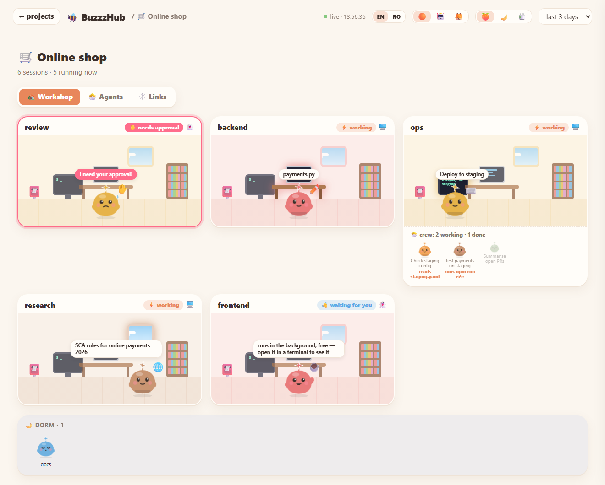
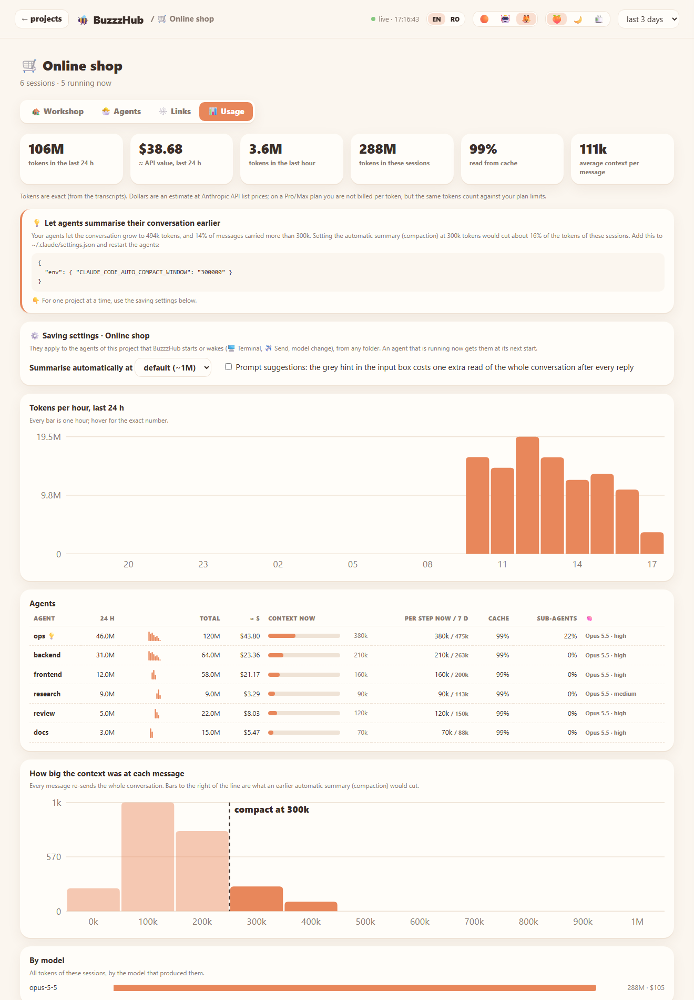
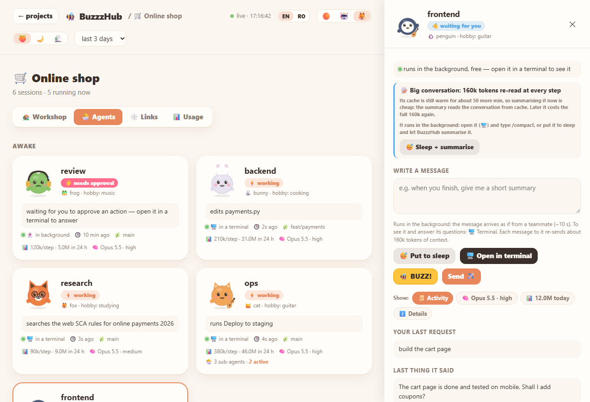
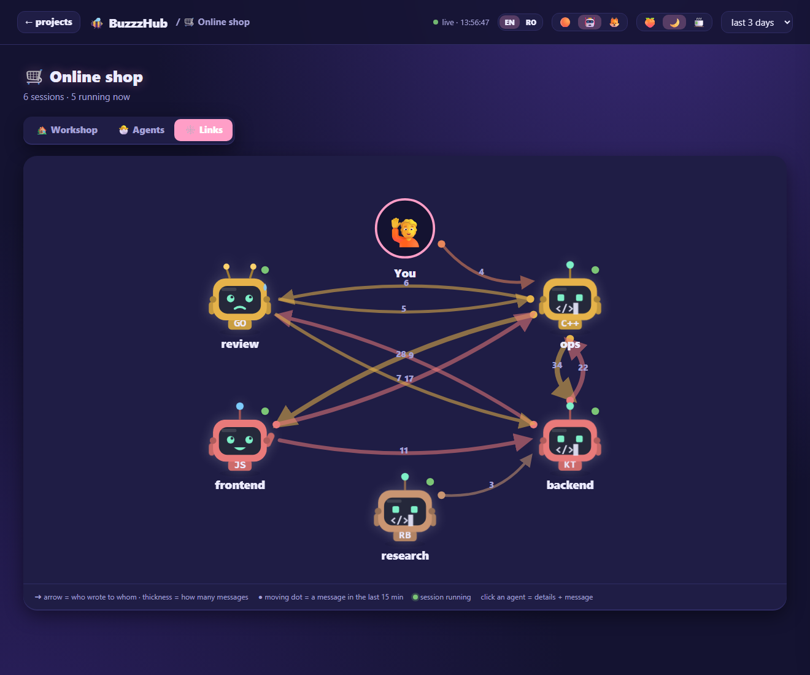

<p align="center"></p>

<h1 align="center">BuzzzHub 🐝</h1>

<p align="center">A small desktop dashboard for all the <b>Claude Code</b> agents working in parallel on your computer.<br>
Pick a project and see every agent as a little mascot in its own room: what it is doing right now, whether it has a question for you, who it is writing to.<br>
Open it in a terminal with one click, send it a message or put it to sleep.</p>

<p align="center"><a href="LICENSE"></a>


</p>

---

<p align="center"></p>
<p align="center"><i>🏡 The workshop: every awake agent has a room and moves around depending on what it is doing (here <b>ops</b> is at the terminal, <b>backend</b> at the desk, <b>research</b> by the window). Its crew of sub-agents sits below the room. <b>review</b> needs your approval, so it comes first.</i></p>

<p align="center"></p>
<p align="center"><i>📊 Usage: tokens and API-equivalent cost per project and agent, live per hour, how big each agent's context is, and local suggestions to spend fewer tokens.</i></p>

<p align="center"></p>
<p align="center"><i>The agents of a project (here as animals with hobbies), each with its status. The side panel shows what the agent is doing; you can write to it, open it in a terminal, change its model and effort, give it a <b>BUZZ!</b> or put it to sleep.</i></p>

<p align="center"></p>
<p align="center"><i>The links map (here with dev robots and the night theme): arrows show who wrote to whom, their thickness how many messages there were.</i></p>

<sub>The screenshots use made-up data: <code>python server.py --demo</code>.</sub>

---

## What it does

- **Projects.** Sessions are grouped by project using the session name, the folder it worked in the most, or keywords from its first requests. The home page shows how many agents are working in each project. From an agent's panel you can move it to another project or to a new one (➕ new project…).
- **Agents.** Every session gets a mascot animated by its status:
  - ⚡ **working**: it bounces and its star spins. You also see what it runs, e.g. "runs Run all tests".
  - 👋 **waiting for you**: it is done and waves at you.
  - 🙋 **has a question** / ✋ **needs approval**: it won't move until you answer. It comes first in the list, with a **🖥️ Answer in terminal** button.
  - 😅 **stuck?**: it stopped at a tool, maybe waiting for a permission.
  - 💤 **sleeping**: the session is closed or untouched for a few hours.
- **🏡 Workshop.** Every awake agent has a room with a mailbox, a terminal, a desk, a window and a bookshelf. The mascot walks to the right spot for what it is doing: the terminal when it runs commands, the desk when it writes code, the shelf when it reads or searches, the window when it searches the web, the mailbox when it sends messages. A speech bubble says exactly what it is doing. Below the room you see its crew of sub-agents, each with its own task. New messages between agents fly as ✉️ envelopes from one room to another. Sleeping agents stay in the dorm. All of it comes from local files, so it costs no tokens.
- **📊 Usage.** Exact token counts for every project, agent and sub-agent, read from the `usage` block Claude Code writes after every reply, for the period you pick (1 hour to 30 days, or any start and end): tokens, an estimate in dollars at API list prices, the average per hour and per day at that pace, steps, how much came from the cache, and a chart over the period (10-minute precision). For each agent you see what one step costs right now (every reply or tool call re-reads the whole conversation), next to its 24-hour and 7-day averages, so you can tell when it starts using less. A histogram shows how big the context was at each message and how much an earlier automatic summary would save. Suggestions are written locally from rules, with no model calls.
- **Details.** Click an agent to see your last request, the last thing it said, what it did recently (tools, files, messages), its sub-agents, its branch and the command to resume it.
- **🕸️ Links.** A map of who wrote to whom (`SendMessage`). The arrow's thickness shows how many messages there were, and a moving dot marks a message from the last 15 minutes. Hover an arrow to read the latest messages.
- **🖥️ Terminal.** Any agent opens in a terminal window with one click (Git Bash by default, with the agent's name in the title), where you see it and answer it:
  - **closed session**: it wakes it in the background (with your message, if you wrote one) and opens it with `claude attach`;
  - **background session**: it opens it with `claude attach`. If you close the window, the agent keeps working and you can reopen it any time;
  - **already open in a terminal**: it brings that window to the front.
  - Note: plain `claude` always starts a new session. For an old one you need `claude attach <id>` (background) or `claude --resume <id>`.
- **🧠 Model & effort.** Every agent shows the model and effort level its last reply used (read from the transcript), on its card, in its room and in the usage table. Change them from its panel: a closed agent gets them the next time you wake it (`claude --resume --model … --effort …`); a running one is restarted in the background with them, and one open in a terminal is reopened in a new window, keeping the conversation. The panel warns that switching models re-processes the whole context once, while changing only the effort keeps the cache on Opus 5.5 and Fable 5.1+.
- **📝 Summarise.** When an agent with a big conversation (150k+ tokens) stops working, its card says so. While its prompt cache is still warm (it worked in the last hour), a summary is cheap: it reads the conversation from cache. A sleeping agent is summarised from the panel with **📝 Summarise now** (`claude -p --resume <id> /compact`, the same session, no fork); a running one with **😴 Sleep + summarise**. The next start then re-reads only the summary.
- **⚙️ Saving settings per project.** In a project's 📊 Usage tab: summarise automatically at 200k / 300k / 500k tokens, and turn prompt suggestions off (each one re-reads the whole conversation after every reply). BuzzzHub passes them with `--settings` to every agent of the project it starts or wakes, from whatever folder the session belongs to.
- **😴 Put to sleep.** Stops a running agent: a background one with `claude stop`, one in a terminal by typing Ctrl+C into its window, so Claude quits by itself and switches the terminal's mouse mode off (it is closed by force only if it does not quit within 8 seconds). The conversation is kept and you wake it any time with 🖥️ Terminal or a message. It asks first, and warns you if the agent is working right then.
- **✈️ Messages.** Write to an agent straight from the app:
  - **running session**: the message reaches it through the official `SendMessage` tool, carried by a short `claude -p` relay on Haiku. The agent sees it as a message from a teammate, so it does not count as your approval;
  - **closed session**: it starts it in the background with your message (`claude --resume <id> --bg`), keeping its name. If the agent then asks you something, you see it on the card and answer from 🖥️ Terminal.
- **🐝 BUZZ!** Like the old messenger nudge: press **BUZZ!** and the agent's card shakes with a buzz. The agent gets a poke: "Buzzz! 🐝 How is it going? Give me a short update…". Handy when an agent seems stuck or has been quiet for a while. Only for running sessions.
- **🐾 Three mascot families:** 🟠 blobs with a star, 🤖 dev robots (a screen face, an LED that blinks while working, a badge with their favourite language: JS, PY, RS, GO…) and 🦊 animals with hobbies (cat, fox, bear, panda, owl, penguin, bunny, frog, puppy or hamster; into music, coffee, code, games, reading, painting, cooking, gardening, guitar, photos or hiking). Each agent always gets the same mascot, based on its name.
- **🎨 Three themes:** 🍑 Cream (follows the system light/dark setting), 🌙 Starry night and 🍵 Matcha.
- **🌍 Two languages:** English and Romanian, switched with **EN / RO** at the top. By default it follows your system language; the app remembers your choice.
- It refreshes every 3 seconds. It runs on **Windows** (WSL sessions included) and **macOS**.

## How it works

To show things, the app only **reads** and never changes anything in `~/.claude`. It starts or stops something only when you press a button (✈️ Send, 🐝 BUZZ!, 🖥️ Terminal, 😴 Put to sleep), and then it uses the official `claude` commands.

| What it shows | Where it comes from |
|---|---|
| sessions, activity, last messages | the transcripts in `~/.claude/projects/*/*.jsonl`, read incrementally |
| exact status of running sessions | `claude agents --json` |
| running sessions missing from `claude agents` | the list of `claude` processes (their `--resume` argument), without starting anything |
| sub-agents and what each one is doing | `<session>/subagents/*.meta.json` and the tail of each sub-agent's transcript |
| token usage | the `usage` block of every reply in the transcripts (and sub-agents' transcripts), counted once per message, indexed in `cache/usage.json` so only new bytes are read |
| links | the `SendMessage` calls in the transcripts. Technical addresses become names via `~/.claude/sessions/*.json` and received messages. |

For WSL sessions the status is estimated from how recently the session wrote and from its last message.

The server listens only on `127.0.0.1` and uses only the Python standard library. The desktop window uses [pywebview](https://pywebview.flowrl.com/): WebView2 on Windows (already part of Windows 10/11) and WebKit on macOS.

## Install

📘 **Step by step, for Windows and macOS: [INSTALL.md](INSTALL.md)**

In short, you need Python 3.10+ and Claude Code (`claude` on your PATH). Then:

| | |
|---|---|
| 🪟 **Windows** | *Code* → *Download ZIP*, extract it, double-click **`install.bat`**, then open **BuzzzHub** from the Desktop |
| 🍎 **macOS** | *Code* → *Download ZIP*, then double-click **`start.command`**. The first time: right-click → *Open*. |

With git:

```bash
git clone https://github.com/andrei-petrache/buzzzhub.git
cd buzzzhub
# Windows:  install.bat
# macOS:    bash start.command
```

Prefer a browser to a window? `start-in-browser.bat` (or `python3 server.py`) opens http://127.0.0.1:4777. Change the port with the `BUZZZHUB_PORT` environment variable.

## Configuration

On the first start the app creates `config.json` from `config.example.json`. It is in `.gitignore`, because it is your local setup.

```json
{
  "your_name": "Ana",
  "terminal": "auto",
  "shared_folders": [],
  "projects": [
    {
      "name": "My app",
      "emoji": "🚀",
      "color": "#f2a65a",
      "description": "backend, frontend, review",
      "titles": ["backend", "frontend", "review"],
      "keywords": ["my app"],
      "paths": ["my-app"]
    }
  ],
  "assignments": {}
}
```

- `titles`: session names (set with `/rename`) that belong to the project.
- `keywords`: words looked up in the session name and its first requests (accents are ignored). The project's own name counts automatically.
- `paths`: pieces of the session's working folder. What counts is the folder the session spent most time in; the home folder, Temp and `.claude` are ignored.
- `shared_folders`: folders where you start sessions from several projects. They count only if nothing else matches.
- `terminal`: `auto` (Git Bash, then Windows Terminal, then cmd), `gitbash`, `wt` or `cmd`.
- `auto_compact` (per project): the automatic summary threshold in tokens (100000–1000000) for the agents BuzzzHub starts.
- `prompt_suggestions` (per project): `false` turns prompt suggestions off for them. Both are set from the project's 📊 Usage tab.
- `pending`: a model/effort chosen in BuzzzHub for a closed agent, applied (and removed) when it next starts.
- `assignments`: manual moves, saved automatically when you pick another project in an agent's panel.
- `your_name`: shown in the messages you send ("from …, via BuzzzHub").
- `scan_wsl` / `extra_roots`: where else to look for transcripts.

Whatever matches nothing goes to **Other**.

Upgrading from an older version? Its `proiecte.json` is copied into `config.json` on the first start (see [INSTALL.md](INSTALL.md#upgrading-from-an-older-version)).

## Files

| File | Role |
|---|---|
| `app.py` | the desktop window (pywebview) |
| `install.bat` / `start.bat` / `start-in-browser.bat` | install and start on Windows |
| `create-shortcut.ps1` | the Desktop shortcut (called by `install.bat`) |
| `start.command` | install (into a `.venv`) and start on macOS |
| `server.py` | the local server: reads the sessions, works out statuses and links, runs the buttons |
| `processes.py` | finds the running `claude` processes and the session of each (a safety net for status) |
| `usage.py` | token usage and cost per session, the local index, the context histogram and the suggestion rules |
| `terminal.py` | opens an agent in a terminal window (Git Bash / Windows Terminal / cmd / Terminal on macOS) |
| `index.html` | the whole interface (HTML/CSS/JS with no dependencies, SVG mascots, English and Romanian texts) |
| `demo.py` | made-up data for `--demo` |
| `make_icon.py` | draws the `buzzzhub.ico` / `buzzzhub.png` icon in code, with no libraries |
| `config.example.json` | the starting configuration |

## Limits

- On macOS it is written to work, but it has not been tried on a real Mac yet. If something breaks, please open an issue.
- WSL status is estimated, not exact.
- WSL sessions can't get messages from the app, because a different `claude` runs there. You can still open them in a terminal (`wsl.exe … claude --resume`).
- Claude starts background sessions only in folders you trusted. Otherwise the app opens the session interactively in a terminal so you can trust the folder once.

## Saving tokens: what we found

We read Anthropic's guides ([costs](https://code.claude.com/docs/en/costs), [prompt caching](https://code.claude.com/docs/en/prompt-caching), [model config](https://code.claude.com/docs/en/model-config)) and measured real sessions with the usage tab. In short:

1. **Context size is the main cost.** Claude Code sends the whole conversation with every request. Thanks to the prompt cache most of it is billed at the cheap cache-read rate, but in long sessions it still dominates: in our own sessions 99% of all tokens were cache reads, with contexts of 400k–950k tokens per message.
2. **Compact earlier.** By default a 1M-token model lets the conversation grow almost to the limit (it compacts at about 967k). `CLAUDE_CODE_AUTO_COMPACT_WINDOW` sets the point where Claude summarises it on its own (minus a 33k buffer). The usage tab estimates what it would save on your sessions; that is a model, not a measurement, since the summary itself costs one read of the conversation. Measured on one of our agents after setting 300k: one step went from 858k to 80k tokens. Set it per project in BuzzzHub, or for everything in `~/.claude/settings.json`:
   ```json
   { "env": { "CLAUDE_CODE_AUTO_COMPACT_WINDOW": "300000" } }
   ```
   A project folder's `.claude/settings.json` only works for sessions started in that folder; many sessions are started elsewhere (e.g. the home folder) and must be resumed from there, which is why BuzzzHub passes the setting with `--settings`. To cover every session however it is started, put it in `~/.claude/settings.json` (inside WSL too, if you run Claude there); BuzzzHub then shows it as the default. In our test, one agent went from about 469k to 175k tokens per step (−60%) and about −30% tokens per hour, while doing twice as many steps per hour, with no loss in quality we could notice.
3. **Clear between unrelated tasks.** `/rename`, then `/clear`, and `/resume` when you come back. `/compact` with a focus ("keep the open decisions") at natural breaks, not mid-task.
4. **Every message wakes the whole context.** A message from another session (or BuzzzHub's ✈️ / 🐝 BUZZ!) to an idle agent starts a new turn that re-sends its entire context. Send fewer, bigger messages. `"crossSessionInbound": "hold"` makes idle agents keep them until their next turn, but then agents that coordinate through messages wait for you.
5. **Breaks longer than the cache lifetime are expensive.** On a subscription the main conversation's cache lives one hour; after a longer pause the next message re-processes everything. Summarise before stepping away, while the cache is warm: that is when it is cheap (📝 in BuzzzHub). `/clear` costs nothing.
6. **Model and effort.** Fable models cost twice as much per token as Opus 5.5; use them where they earn it. Lower `/effort` for routine steps. Give reading-heavy sub-agents `model: haiku` or `sonnet`.
7. **Keep the always-loaded context small.** `CLAUDE.md` under ~200 lines; move workflow-specific instructions into skills, which load only when used; disable MCP servers you don't use.
8. **Background requests.** Prompt suggestions re-read the conversation after every reply; agents that mostly work alone don't need them (`"promptSuggestionEnabled": false`, or per project in BuzzzHub). Session recaps, `/loop`, goal check-ins and messages from other sessions also start turns while you are away. Run `/usage` in Claude Code for its own breakdown and recommendations.

**Should BuzzzHub keep its own store so agents don't re-read their history?** For BuzzzHub itself, yes: it now keeps a small index of every transcript's token totals (`cache/usage.json`, about 100 KB for 450 MB of transcripts), so it reads each file once and then only new bytes, and the dashboard costs no tokens at all. For the agents, no: they don't re-read their history from disk; the history lives in their conversation and is re-sent to the model with every message. What shrinks that is a smaller conversation (compaction, `/clear`), and the right "local store" for knowledge that must survive is what Claude Code already has: `CLAUDE.md`, auto memory and skills.

## What it costs

Almost nothing. The dashboard, the workshop, the statuses, the sub-agents and the map all come from Claude's local files and the process list, with no tokens. Only these use a little:

- **✈️ a message or 🐝 BUZZ!** to a running session: a short `claude -p` relay on Haiku carries it;
- **📝 Summarise**: one request that reads the conversation, mostly from cache if the agent worked in the last hour;
- **what the agent does next**: your message puts it to work, just as if you had typed it to it directly.

## License

[MIT](LICENSE): you may use, copy, change and share it freely, as long as you keep the copyright notice.
