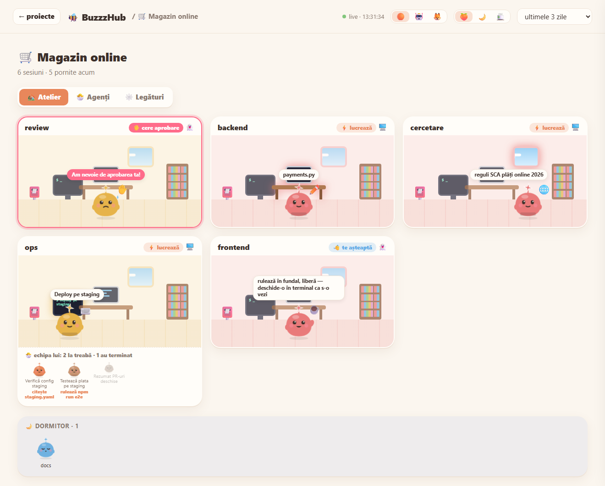

<p align="center"></p>

<h1 align="center">BuzzzHub 🐝</h1>

<p align="center">Un panou mic de desktop pentru toți agenții <b>Claude Code</b> care lucrează în paralel pe PC-ul tău.<br>
Alegi proiectul și vezi fiecare agent ca o mascotă mică în camera lui: ce face acum, dacă te întreabă ceva, cui scrie.<br>
Îl deschizi cu un click în terminal, îi trimiți mesaje sau îl pui la somn.</p>

<p align="center"><a href="LICENSE"></a>

</p>

---

<p align="center"></p>
<p align="center"><i>🏡 Atelierul: fiecare agent treaz stă în camera lui și se mută după ce face (aici <b>ops</b> e la terminal, <b>backend</b> la birou, <b>cercetare</b> la fereastră). Sub cameră îi vezi echipa de sub-agenți. <b>review</b> are nevoie de aprobarea ta, așa că e primul.</i></p>

<p align="center"></p>
<p align="center"><i>Agenții unui proiect (aici ca animăluțe cu pasiuni), fiecare cu starea lui. Panoul din dreapta arată ce face agentul; îi poți scrie sau îi poți da un <b>BUZZ!</b></i></p>

<p align="center"></p>
<p align="center"><i>Harta legăturilor (aici cu roboței dev): săgețile arată cine cui a scris, iar grosimea lor câte mesaje au fost.</i></p>

<sub>Capturile sunt făcute cu date inventate: <code>python server.py --demo</code>.</sub>

---

## Ce face

- **Proiecte.** Sesiunile sunt grupate pe proiecte după numele sesiunii, după folderul în care au lucrat cel mai mult sau după cuvinte-cheie din primele cereri. Pe prima pagină vezi câți agenți lucrează în fiecare proiect. Din panoul unui agent îl poți muta în alt proiect sau într-unul nou (➕ proiect nou…).
- **Agenți.** Fiecare sesiune are o mascotă animată după stare:
  - ⚡ **lucrează**: țopăie, iar steluța se învârte. Vezi și ce rulează, de exemplu „rulează Run all tests”.
  - 👋 **te așteaptă**: a terminat și îți face cu mâna.
  - 🙋 **te întreabă** / ✋ **cere aprobare**: agentul stă pe loc până îi răspunzi. Apare primul în listă, cu butonul **🖥️ Răspunde în terminal**.
  - 😅 **blocat?**: s-a oprit la o unealtă, poate așteaptă o permisiune.
  - 💤 **doarme**: sesiune închisă sau neatinsă de câteva ore.
- **🏡 Atelier.** Fiecare agent treaz are camera lui: cutie poștală, terminal, birou, fereastră și raft cu cărți. Mascota se mută la locul potrivit pentru ce face acum: la terminal când rulează comenzi, la birou când scrie cod, la raft când citește sau caută, la fereastră când caută pe web, la poștă când trimite mesaje. Deasupra are un balon cu ce face. Sub cameră îi vezi echipa de sub-agenți, fiecare cu treaba lui. Mesajele noi dintre agenți zboară ca plicuri ✉️ de la o cameră la alta. Cine doarme stă în dormitor. Totul se calculează din fișierele locale, deci nu costă niciun token.
- **Detalii.** Click pe un agent și vezi ultima ta cerere, ultimul lucru spus, ce a făcut recent (unelte, fișiere, mesaje), sub-agenții, branch-ul și comanda `claude --resume`.
- **🕸️ Legături.** O hartă cu cine cui a scris (`SendMessage`). Grosimea săgeții arată câte mesaje au fost, iar bulina care curge arată un mesaj din ultimele 15 minute. Treci cu mouse-ul peste o săgeată ca să vezi ultimele mesaje.
- **🐝 BUZZ!** Ca pe vremuri pe messenger: apeși **BUZZ!** și cardul agentului se scutură cu un bâzâit. Agentul primește un ghiont: „Buzzz! 🐝 Ce faci? Dă-mi un update scurt…”. E util când un agent pare blocat sau tace de mult. Merge doar la sesiunile pornite.
- **🖥️ Terminal.** Orice agent se deschide cu un click într-o fereastră de terminal (implicit Git Bash, cu numele agentului în titlu), unde îl vezi și îi răspunzi:
  - **sesiune închisă**: o trezește în fundal (cu mesajul tău, dacă ai scris unul) și o deschide cu `claude attach`;
  - **sesiune în fundal**: o deschide cu `claude attach`. Dacă închizi fereastra, agentul lucrează mai departe și îl poți redeschide oricând;
  - **sesiune deschisă deja într-un terminal**: îți aduce fereastra ei în față.
  - Atenție: `claude` simplu pornește mereu o sesiune nouă. Pentru una veche e nevoie de `claude attach <id>` (fundal) sau `claude --resume <id>`.
- **😴 Pune la somn.** Oprește un agent pornit: cel din fundal cu `claude stop`, cel dintr-un terminal închizându-i procesul `claude`. Conversația rămâne salvată și îl trezești oricând cu 🖥️ Terminal sau cu un mesaj. Îți cere confirmare, mai ales dacă agentul lucrează chiar atunci.
- **✈️ Mesaje.** Poți scrie unui agent direct din aplicație:
  - **sesiune pornită**: mesajul ajunge în ea prin unealta oficială `SendMessage`, printr-un releu scurt `claude -p` pe Haiku. Agentul îl vede ca mesaj de la un coleg, deci nu e echivalent cu o aprobare de-a ta;
  - **sesiune închisă**: o pornește în fundal cu mesajul tău (`claude --resume <id> --bg`), păstrându-i numele. Dacă agentul îți pune apoi o întrebare, o vezi pe card și îi răspunzi din 🖥️ Terminal.
- **🐾 Trei familii de mascote:** 🟠 bulgărași cu steluță, 🤖 roboței dev (ecran pe față, LED care clipește când lucrează, plăcuță cu limbajul preferat: JS, PY, RS, GO…) și 🦊 animăluțe cu pasiuni. Animăluțele sunt pisică, vulpe, urs, panda, bufniță, pinguin, iepuraș, broscuță, cățel sau hamster, fiecare cu o pasiune: muzică, cafea, cod, jocuri, citit, pictură, gătit, grădinărit, chitară, foto, drumeții. Fiecare agent își primește mereu aceeași mascotă, după nume.
- **🎨 Trei teme:** 🍑 Cremă (urmează tema deschisă sau închisă a sistemului), 🌙 Noapte cu stele și 🍵 Matcha. Aplicația o ține minte pe cea aleasă.
- Se actualizează singur la 3 secunde. Merge pe **Windows** (inclusiv cu sesiunile din WSL) și pe **macOS**.

## Cum funcționează

Ca să afișeze, aplicația doar **citește** și nu modifică nimic din `~/.claude`. Pornește sau oprește ceva numai când apeși tu un buton (✈️ Trimite, 🐝 BUZZ!, 🖥️ Terminal, 😴 Pune la somn), și atunci folosește comenzile oficiale `claude`.

| Ce arată | De unde vine |
|---|---|
| sesiuni, activitate, ultimele mesaje | transcrierile `~/.claude/projects/*/*.jsonl`, citite incremental |
| stare exactă pentru sesiunile pornite | `claude agents --json` |
| sesiuni pornite care lipsesc din `claude agents` | lista proceselor `claude` (argumentul `--resume`), fără să pornească nimic |
| sub-agenți | `<sesiune>/subagents/*.meta.json` |
| legături | apelurile `SendMessage` din transcrieri. Adresele tehnice se traduc în nume din `~/.claude/sessions/*.json` și din mesajele primite. |

Pentru sesiunile din WSL, starea e estimată din cât de recent a scris sesiunea și din ultimul ei mesaj.

Serverul ascultă doar pe `127.0.0.1` și folosește numai biblioteca standard Python. Fereastra de desktop folosește [pywebview](https://pywebview.flowrl.com/): pe Windows rulează peste WebView2, care e deja inclus în Windows 10/11, iar pe macOS peste WebKit.

## Instalare

📘 **Pas cu pas, pentru Windows și macOS: [GHID-INSTALARE.md](GHID-INSTALARE.md)** (în română și engleză)

Pe scurt, ai nevoie de Python 3.10+ și de Claude Code (`claude` în PATH). Apoi:

| | |
|---|---|
| 🪟 **Windows** | *Code* → *Download ZIP*, dezarhivezi, dublu-click pe **`instaleaza.bat`**, apoi deschizi **BuzzzHub** de pe Desktop |
| 🍎 **macOS** | *Code* → *Download ZIP*, apoi dublu-click pe **`porneste.command`**. Prima dată: click dreapta → *Open*. |

Cu git:

```bash
git clone https://github.com/andrei-petrache/buzzzhub.git
cd buzzzhub
# Windows:  instaleaza.bat
# macOS:    bash porneste.command
```

Dacă îl vrei în browser în loc de fereastră: `porneste-in-browser.bat` (sau `python3 server.py`) deschide http://127.0.0.1:4777. Portul se schimbă cu variabila `AGENTI_PORT`.

## Configurare

La prima pornire se creează `proiecte.json` din `proiecte.exemplu.json`. Fișierul e în `.gitignore`, pentru că e configurarea ta locală.

```json
{
  "numele_tau": "Ana",
  "terminal": "auto",
  "foldere_comune": [],
  "proiecte": [
    {
      "nume": "Aplicația mea",
      "emoji": "🚀",
      "culoare": "#f2a65a",
      "descriere": "backend, frontend, review",
      "titluri": ["backend", "frontend", "review"],
      "cuvinte": ["aplicatia mea"],
      "cai": ["aplicatia-mea"]
    }
  ],
  "alocari": {}
}
```

- `titluri`: numele sesiunilor (dat cu `/rename`) care țin de proiect.
- `cuvinte`: cuvinte-cheie căutate în numele sesiunii și în primele cereri (fără diacritice, ex. „bucataria”). Numele proiectului contează automat.
- `cai`: bucăți din folderul de lucru al sesiunii. Contează folderul în care sesiunea a stat cel mai mult; folderul de acasă, Temp și `.claude` sunt ignorate.
- `foldere_comune`: foldere în care pornești sesiuni din mai multe proiecte (ex. `D:/claude`). Contează doar dacă nimic altceva nu se potrivește.
- `terminal`: `auto` (Git Bash, apoi Windows Terminal, apoi cmd), `gitbash`, `wt` sau `cmd`.
- `alocari`: mutările manuale, salvate automat când alegi alt proiect din panoul unui agent.
- `numele_tau`: apare în mesajele trimise („de la …, prin BuzzzHub”).
- `cauta_wsl` / `radacini_extra`: unde mai caută transcrieri.

Ce nu se potrivește nicăieri ajunge în **Diverse**.

## Fișiere

| Fișier | Rol |
|---|---|
| `app.py` | fereastra de desktop (pywebview) |
| `instaleaza.bat` / `porneste.bat` | instalare și pornire pe Windows |
| `porneste.command` | instalare (într-un `.venv`) și pornire pe macOS |
| `server.py` | serverul local: citește sesiunile, calculează stările și legăturile, trimite mesaje |
| `procese.py` | găsește procesele `claude` care rulează și sesiunea fiecăruia (plasă de siguranță pentru stare) |
| `terminal.py` | deschide un agent într-o fereastră de terminal (Git Bash / Windows Terminal / cmd / Terminal pe macOS) |
| `index.html` | toată interfața (HTML/CSS/JS fără dependențe, mascote SVG) |
| `fa_iconita.py` | desenează iconița `buzzzhub.ico` / `buzzzhub.png` din cod, fără biblioteci |
| `proiecte.exemplu.json` | configurare de pornire |

## Limite

- Pe macOS l-am scris să meargă, dar nu l-am testat încă pe un Mac real. Dacă ceva nu merge, deschide un issue.
- Starea din WSL e estimată, nu exactă.
- Sesiunile din WSL nu pot primi mesaje din aplicație, pentru că acolo rulează alt `claude`. Le poți deschide în terminal (`wsl.exe … claude --resume`).
- O sesiune poate porni în fundal doar într-un folder pe care l-ai marcat ca sigur în Claude. Altfel aplicația o deschide interactiv în terminal, ca să confirmi o dată.
- Un mesaj către o sesiune pornită costă puțin, pentru că pornește un releu scurt pe Haiku.

## Ce costă

Aproape nimic. Panoul, atelierul, stările, sub-agenții și harta se calculează din fișierele locale ale lui Claude și din lista de procese, fără tokeni. Consumă puțin doar:

- **✈️ un mesaj sau 🐝 BUZZ!** către o sesiune pornită: un releu scurt `claude -p` pe Haiku îl duce;
- **ce face agentul după aceea**: mesajul tău îl pune la treabă, la fel ca și cum i-ai fi scris direct.

## Licență

[MIT](LICENSE): îl poți folosi, copia, modifica și distribui liber, cu păstrarea notei de copyright.
