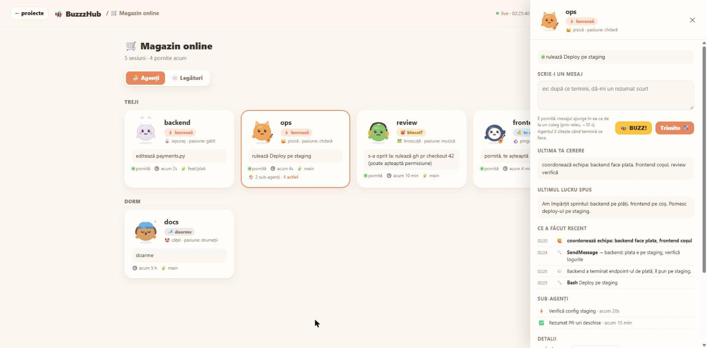
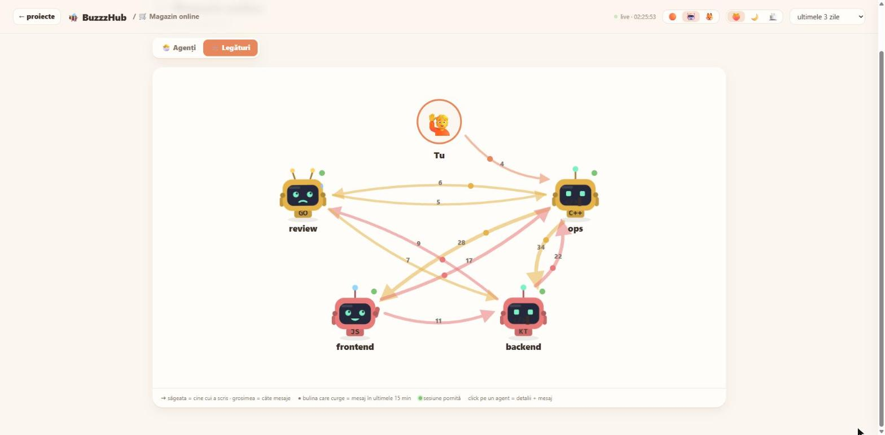

<p align="center"></p>

<h1 align="center">BuzzzHub 🐝</h1>

<p align="center">Un panou mic de desktop pentru toți agenții <b>Claude Code</b> care lucrează în paralel pe PC-ul tău.<br>
Alegi proiectul și vezi fiecare agent ca o mascotă mică: ce face acum, dacă te așteaptă, cui scrie. Îi poți și trimite mesaje.</p>

---

<p align="center"></p>
<p align="center"><i>Agenții unui proiect (aici ca animăluțe cu pasiuni), fiecare cu starea lui. Panoul din dreapta arată ce face agentul; îi poți scrie sau îi poți da un <b>BUZZ!</b></i></p>

<p align="center"></p>
<p align="center"><i>Harta legăturilor (aici cu roboței dev): săgețile arată cine cui a scris, iar grosimea lor câte mesaje au fost.</i></p>

<sub>Capturile sunt făcute cu date inventate: <code>python server.py --demo</code>.</sub>

---

## Ce face

- **Proiecte.** Sesiunile sunt grupate pe proiecte după numele sesiunii sau după folder. Pe prima pagină vezi câți agenți lucrează în fiecare proiect.
- **Agenți.** Fiecare sesiune are o mascotă animată după stare:
  - ⚡ **lucrează**: țopăie, iar steluța se învârte. Vezi și ce rulează, de exemplu „rulează Run all tests”.
  - 👋 **te așteaptă**: a terminat și îți face cu mâna.
  - 😅 **blocat?**: s-a oprit la o unealtă, poate așteaptă o permisiune.
  - 💤 **doarme**: sesiune închisă sau neatinsă de câteva ore.
- **Detalii.** Click pe un agent și vezi ultima ta cerere, ultimul lucru spus, ce a făcut recent (unelte, fișiere, mesaje), sub-agenții, branch-ul și comanda `claude --resume`.
- **🕸️ Legături.** O hartă cu cine cui a scris (`SendMessage`). Grosimea săgeții arată câte mesaje au fost, iar bulina care curge arată un mesaj din ultimele 15 minute. Treci cu mouse-ul peste o săgeată ca să vezi ultimele mesaje.
- **🐝 BUZZ!** Ca pe vremuri pe messenger: apeși **BUZZ!** și cardul agentului se scutură cu un bâzâit. Agentul primește un ghiont: „Buzzz! 🐝 Ce faci? Dă-mi un update scurt…”. E util când un agent pare blocat sau tace de mult. Merge doar la sesiunile pornite.
- **✈️ Mesaje.** Poți scrie unui agent direct din aplicație:
  - **sesiune pornită**: mesajul ajunge în ea prin unealta oficială `SendMessage`, printr-un releu scurt `claude -p` pe Haiku. Agentul îl vede ca mesaj de la un coleg, deci nu e echivalent cu o aprobare de-a ta;
  - **sesiune închisă**: o pornește în fundal cu mesajul tău (`claude --resume <id> --bg`).
- **🐾 Trei familii de mascote:** 🟠 bulgărași cu steluță, 🤖 roboței dev (ecran pe față, LED care clipește când lucrează, plăcuță cu limbajul preferat: JS, PY, RS, GO…) și 🦊 animăluțe cu pasiuni. Animăluțele sunt pisică, vulpe, urs, panda, bufniță, pinguin, iepuraș, broscuță, cățel sau hamster, fiecare cu o pasiune: muzică, cafea, cod, jocuri, citit, pictură, gătit, grădinărit, chitară, foto, drumeții. Fiecare agent își primește mereu aceeași mascotă, după nume.
- **🎨 Trei teme:** 🍑 Cremă (urmează tema deschisă sau închisă a sistemului), 🌙 Noapte cu stele și 🍵 Matcha. Aplicația o ține minte pe cea aleasă.
- Se actualizează singur la 3 secunde. Merge pe **Windows** (inclusiv cu sesiunile din WSL) și pe **macOS**.

## Cum funcționează

Aplicația doar **citește**. Nu modifică nimic din `~/.claude`:

| Ce arată | De unde vine |
|---|---|
| sesiuni, activitate, ultimele mesaje | transcrierile `~/.claude/projects/*/*.jsonl`, citite incremental |
| stare exactă pentru sesiunile pornite | `claude agents --json` |
| sub-agenți | `<sesiune>/subagents/*.meta.json` |
| legături | apelurile `SendMessage` din transcrieri. Adresele tehnice se traduc în nume din `~/.claude/sessions/*.json` și din mesajele primite. |

Pentru sesiunile din WSL, starea e estimată din cât de recent a scris sesiunea și din ultimul ei mesaj.

Serverul ascultă doar pe `127.0.0.1` și folosește numai biblioteca standard Python. Fereastra de desktop folosește [pywebview](https://pywebview.flowrl.com/): pe Windows rulează peste WebView2, care e deja inclus în Windows 10/11, iar pe macOS peste WebKit.

## Instalare

📘 **Pas cu pas, pentru Windows și macOS: [GHID-INSTALARE.md](GHID-INSTALARE.md)** (în română și engleză)

Pe scurt, ai nevoie de Python 3.10+ și de Claude Code (`claude` în PATH). Apoi:

| | |
|---|---|
| 🪟 **Windows** | *Code* → *Download ZIP*, dezarhivezi, dublu-click pe **`instaleaza.bat`**, apoi deschizi **BuzzzHub** de pe Desktop |
| 🍎 **macOS** | *Code* → *Download ZIP*, apoi dublu-click pe **`porneste.command`**. Prima dată: click dreapta → *Open*. |

Cu git:

```bash
git clone https://github.com/andrei-petrache/buzzzhub.git
cd buzzzhub
# Windows:  instaleaza.bat
# macOS:    bash porneste.command
```

Dacă îl vrei în browser în loc de fereastră: `porneste-in-browser.bat` (sau `python3 server.py`) deschide http://127.0.0.1:4777. Portul se schimbă cu variabila `AGENTI_PORT`.

## Configurare

La prima pornire se creează `proiecte.json` din `proiecte.exemplu.json`. Fișierul e în `.gitignore`, pentru că e configurarea ta locală.

```json
{
  "numele_tau": "Ana",
  "proiecte": [
    {
      "nume": "Aplicația mea",
      "emoji": "🚀",
      "culoare": "#f2a65a",
      "descriere": "backend, frontend, review",
      "titluri": ["backend", "frontend", "review"],
      "cai": ["aplicatia-mea"]
    }
  ],
  "alocari": {}
}
```

- `titluri`: numele sesiunilor (dat cu `/rename`) care țin de proiect.
- `cai`: bucăți din folderul de lucru al sesiunii.
- `alocari`: mutările manuale, salvate automat când alegi alt proiect din panoul unui agent.
- `numele_tau`: apare în mesajele trimise („de la …, prin BuzzzHub”).
- `cauta_wsl` / `radacini_extra`: unde mai caută transcrieri.

Ce nu se potrivește nicăieri ajunge în **Diverse**.

## Fișiere

| Fișier | Rol |
|---|---|
| `app.py` | fereastra de desktop (pywebview) |
| `instaleaza.bat` / `porneste.bat` | instalare și pornire pe Windows |
| `porneste.command` | instalare (într-un `.venv`) și pornire pe macOS |
| `server.py` | serverul local: citește sesiunile, calculează stările și legăturile, trimite mesaje |
| `index.html` | toată interfața (HTML/CSS/JS fără dependențe, mascote SVG) |
| `fa_iconita.py` | desenează iconița `buzzzhub.ico` / `buzzzhub.png` din cod, fără biblioteci |
| `proiecte.exemplu.json` | configurare de pornire |

## Limite

- Pe macOS l-am scris să meargă, dar nu l-am testat încă pe un Mac real. Dacă ceva nu merge, deschide un issue.
- Starea din WSL e estimată, nu exactă.
- Sesiunile din WSL nu pot primi mesaje din aplicație, pentru că acolo rulează alt `claude`.
- Un mesaj către o sesiune pornită costă puțin, pentru că pornește un releu scurt pe Haiku.
